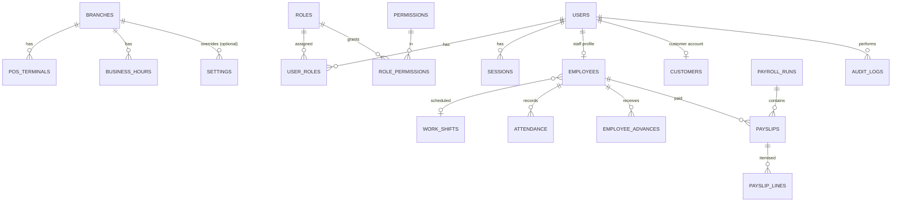
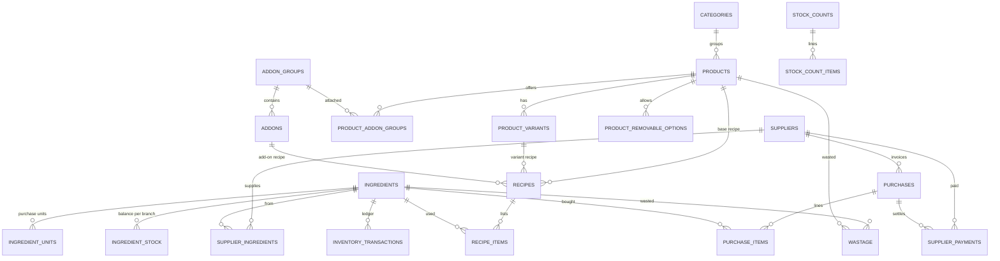
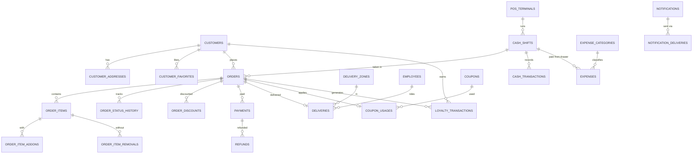

# Food Business ERP, POS & Online Ordering — Architecture Proposal

Status: **APPROVED 2026-10-12 with recommended defaults** (decisions recorded in PHASES.md)
Date: 2026-10-12
Scope: single-branch restaurant / fast-food business, fewer than 10 staff, Pakistan (PKR, Asia/Karachi), ready for multiple branches later.

---

## 0. Executive summary

| Decision | Recommendation |
|---|---|
| Application shape | **One Next.js application, built as a modular monolith.** Customer PWA, POS, KDS, Rider view and Admin are route groups of the same app and share one domain/service layer. |
| Backend | **No separate NestJS service for now.** Business logic lives in a framework-independent `src/server/modules/*` service layer. Next.js Route Handlers and Server Actions are thin adapters on top of it. The layer can be moved into NestJS later without rewriting business rules. |
| Database | PostgreSQL (Supabase managed, Mumbai region) via **Prisma ORM** with versioned migrations. |
| Auth | **Better Auth** (database sessions, httpOnly cookies, strong password hashing, built-in rate limiting) plus custom RBAC tables. Staff PIN quick-switch on POS terminals. |
| Real-time | **"Ping-then-fetch"**: the server publishes change events with no personal data (`order.updated {orderId}`) over Supabase Realtime. Screens then refetch through the authorised API. Polling every 15 s is the fallback. The provider sits behind an interface so it can be swapped for Pusher or Ably. |
| UI | Tailwind CSS v4 + shadcn/ui (Radix) design system, lucide icons, Recharts, TanStack Query (server state), Zustand (POS cart), React Hook Form + Zod. |
| Money | `NUMERIC(12,2)` in the database, `Prisma.Decimal`/decimal.js in code. **JavaScript `number` arithmetic is never used on money.** Quantities are `NUMERIC(14,3)` in ingredient base units. |
| Hosting | Vercel Pro (app, region `bom1` Mumbai) + Supabase Pro (Postgres, Storage, Realtime, backups, `ap-south-1`) + Upstash Redis (rate limiting) + Resend (email) + Sentry (errors). |
| Delivery plan | Your 10 phases, with two small re-orderings (§13). **Recommended go-live after Phase 5** (POS + KDS + online ordering) while back-office modules continue. |

**Why not NestJS now.** The business is small and there is one developer. A second deployable doubles hosting, auth plumbing, CORS and security surface for no current benefit. The real benefit of NestJS, a clean and testable domain layer, is achieved by the service-layer pattern below. A dedicated backend becomes worthwhile with native mobile apps at scale, long-lived WebSocket needs, or several development teams.

---

## 1. Requirements analysis

### 1.1 What the system really is
Four operational front-ends over one transactional core:

1. **Order core.** Every order (web, PWA, POS, phone, admin, aggregator) is one `orders` record with one lifecycle, one numbering scheme and one payment model.
2. **Stock core.** An append-only inventory ledger fed by purchases, sales (through recipes), wastage, adjustments and stock counts.
3. **Cash core.** Cash shifts and cash transactions that reconcile every rupee passing through the drawer: sales, refunds, expenses, rider cash-on-delivery settlements, supplier payouts.
4. **People core.** Employees, attendance, payroll, and the users/roles that drive permissions.

Reporting, loyalty, coupons, notifications and audit read from or hook into those cores.

### 1.2 Critical non-functional requirements
| Requirement | Architectural consequence |
|---|---|
| POS must be extremely fast | Menu cached client-side; cart is pure client state; placing an order is one round-trip; no full-page reloads. |
| Never delete financial records | Master data is soft-deleted. Orders, payments and expenses are cancelled, voided or refunded, never deleted. Database triggers block `DELETE` on financial tables. |
| Duplicate-request safety | Every mutating POS, checkout and sync request carries an **idempotency key**. `orders.idempotency_key` is UNIQUE. |
| Concurrent orders | Order numbers come from a row-locked counter. Stock and cash changes run inside database transactions. Orders carry a `version` column for optimistic locking. |
| Backend-enforced RBAC | Every service function receives a `ctx` and calls `authorize(ctx, 'permission.key')`. Data-scope rules (own shift, assigned deliveries) are applied inside queries. |
| Offline later | Client-generated UUIDs, idempotent order creation, server as source of truth, explicit conflict flags. Designed now, built in Phase 9. |
| Future multi-branch | `branch_id` on every operational table now. One seeded "Main Branch", hidden from the UI. |
| Not a certified accounting system | All profit figures are labelled **"Estimated"**. Cost of goods comes from recipe cost snapshots taken at sale time. |

### 1.3 Gaps and contradictions in the brief, and how this design resolves them
- **Order statuses** are a single linear chain, but takeaway and dine-in never go OUT_FOR_DELIVERY, and held POS orders must never reach the kitchen. → A status machine per order type, plus a `HELD` pre-state (§5.4).
- **"Inventory deducts when completed/sold."** Deducting at COMPLETED makes stock look higher during a rush. Deducting at creation breaks on cancellations. → Deduct when the order enters **PREPARING** (configurable: ACCEPTED, PREPARING or COMPLETED). A cancellation before that point reverses nothing. A cancellation after it moves the ingredients to wastage automatically instead of back into stock.
- **Units** such as pack, box and bottle are ingredient-specific. → Each ingredient has a base unit (g, ml, piece) plus its own purchase-unit conversions (1 box of cola = 24 bottles).
- **Add-ons** as a flat list cannot express "choose 1 drink (required)" in a deal. → Add-on *groups* with minimum/maximum selection rules.
- **"payroll" and "payroll_items"** → modelled as `payroll_runs` (the month), `payslips` (per employee) and `payslip_lines` (earnings and deductions).
- **Late-night trading.** A shift from 6 pm to 3 am must count as one business day. → Each order gets a `business_date` using a configurable day-cutoff hour (for example 05:00).
- **Negative stock.** Real kitchens sell food even when the system count is wrong. → Stock may go negative by default (configurable), with an alert, rather than blocking sales.

---

## 2. Recommended architecture

```
                       ┌──────────────────────── Vercel (bom1) ─────────────────────────┐
 Customers (mobile) ──►│  Next.js app                                                   │
 POS tablet/PC ───────►│   ├─ (customer) PWA routes      ─┐                             │
 Kitchen screen ──────►│   ├─ /pos  /kitchen  /rider      │  thin adapters              │
 Owner/Manager ───────►│   ├─ /admin                      │  (Server Components,        │
                       │   ├─ /api/v1/*  Route Handlers   │   Server Actions,           │
                       │   └─ /api/cron/* /api/webhooks/* ┘   Route Handlers)           │
                       │                    │                                           │
                       │        src/server/modules/*  (domain services, RBAC,           │
                       │        validation, transactions, audit, events)                │
                       └────────────┬───────────────┬──────────────────┬────────────────┘
                                    │ Prisma        │ publish ping     │ rate limit
                       ┌────────────▼──────┐ ┌──────▼────────┐  ┌──────▼──────┐
                       │ Supabase Postgres │ │ Supabase      │  │Upstash Redis│
                       │ (pooler :6543)    │ │ Realtime      │  └─────────────┘
                       │ + Storage buckets │ │ (broadcast)   │
                       └───────────────────┘ └───────────────┘
   Later: payment gateway webhooks, SMS/WhatsApp provider, Resend email, Sentry,
          nightly off-site backup (GitHub Actions → Cloudflare R2 / Backblaze B2)
```

### 2.1 Layering rules
1. **UI layer** (`src/app`, `src/features`) renders and collects input. It never imports Prisma.
2. **Adapter layer.** Server Actions serve admin forms. Route Handlers under `/api/v1` serve POS, KDS, PWA, rider, sync and webhooks. Every adapter does the same five steps: authenticate, build `ctx`, parse input with the module's Zod schema, call the service, map errors to HTTP.
3. **Service layer** (`src/server/modules/<module>/service.ts`) holds business rules, `authorize()`, transactions, audit writes and domain events. It has no Next.js imports, so it is unit-testable.
4. **Data layer.** One pooled Prisma client. Raw SQL only for reports and locked counters.

### 2.2 Cross-cutting core (`src/server/core`)
| Piece | Responsibility |
|---|---|
| `db` | Prisma client, `withTransaction(fn)`, retry on serialization failure |
| `auth` | Better Auth config, session lookup, staff PIN verification, manager-override tokens |
| `rbac` | `authorize(ctx, perm)`, `can(ctx, perm)`, scope helpers (own shift, assigned deliveries) |
| `audit` | `audit.record(tx, {...})`, always inside the same transaction as the change |
| `money` | Decimal helpers, rounding rules, tax calculation, PKR formatting |
| `events` | Transactional **outbox**: events written inside the business transaction, dispatched after commit |
| `realtime` | `RealtimePublisher` interface with a Supabase implementation; channel names only, no personal data |
| `idempotency` | Idempotency-key store for mutating endpoints |
| `errors` | `AppError` hierarchy with stable codes (`ORDER_NOT_FOUND`, `PERMISSION_DENIED`, `INVALID_STATUS_TRANSITION` …) |
| `settings` | Typed settings registry (Zod-validated JSON per key), cached per request |
| `numbering` | Locked counters for order, expense, purchase and wastage numbers |
| `storage` | Signed upload URLs; public bucket for menu images, private bucket for receipts and documents |

### 2.3 Real-time design
- After commit, the outbox dispatcher publishes `{"type":"order.updated","orderId":"…","status":"PREPARING"}` to channels such as `branch:{id}:kds`, `branch:{id}:orders`, `rider:{employeeId}` and `track:{trackingToken}`.
- Payloads carry **IDs and statuses only**. Screens fetch details through authorised endpoints, so a leaked channel name exposes nothing personal.
- KDS and POS also poll every 15 s as a safety net and refetch on window focus and reconnect.
- KDS sound: a short local audio file plays on new-order events after the user taps "Enable sound" once, because browsers block autoplay.

### 2.4 Technology choices
| Need | Choice | Reason |
|---|---|---|
| Framework | Next.js (App Router, latest stable at Phase 1), React 19, TypeScript strict | Requested; Server Components keep admin pages light. |
| ORM | Prisma (multi-file schema, `pg` driver adapter) | Mature migrations, typed client, Decimal support. |
| Auth | Better Auth | Sessions stored in our own database, Prisma adapter, rate limiting, email + password, phone OTP plugin later. No vendor lock-in. |
| Validation | Zod | Shared by client forms and server. |
| UI kit | shadcn/ui + Tailwind v4 | Components we own, consistent design tokens, accessible Radix primitives. |
| Tables | TanStack Table | Sorting, filtering and pagination for admin lists and reports. |
| Charts | Recharts | Adequate and light for dashboards. |
| PWA | Serwist | Maintained successor of next-pwa; service worker and precache; IndexedDB offline queue later. |
| Exports | CSV (native), Excel (`exceljs`), PDF (print CSS first, `@react-pdf/renderer` for payslips) | |
| Testing | Vitest (unit, integration), Playwright (E2E, responsive), real Postgres in Docker for integration tests | |
| Observability | Sentry, Vercel logs, structured `pino` logs | |

Exact package versions are pinned at Phase 1 install time.

---

## 3. Module map

```
                          ┌──────────────┐
                          │   settings   │◄──────────── every module reads settings
                          └──────────────┘
 ┌──────┐   ┌───────┐   ┌────────────┐   ┌──────────────┐
 │ auth │──►│ users │──►│ rbac/roles │──►│    audit     │◄── every sensitive mutation
 └──────┘   └───────┘   └────────────┘   └──────────────┘
                 │
           ┌─────▼─────┐   ┌────────────┐   ┌─────────┐   ┌──────────┐
           │ employees │──►│ attendance │──►│ payroll │──►│ expenses │
           └───────────┘   └────────────┘   └─────────┘   └────┬─────┘
                                                                │ cash expense
 ┌──────┐   ┌─────────┐   ┌──────────────────┐   ┌────────────┐ │
 │ menu │──►│ recipes │──►│    inventory     │◄──│ purchases  │◄┼── suppliers
 └──┬───┘   └─────────┘   │ (ledger, stock,  │   └────────────┘ │
    │                     │  counts, wastage)│                  │
    │                     └────────▲─────────┘                  │
    │                              │ deduct on PREPARING        │
 ┌──▼───────────────────────────────┴──┐   ┌──────────┐   ┌─────▼──────┐
 │               orders                │──►│ payments │──►│ cash-shifts│
 │  (pos, customer web, phone, admin)  │   │ refunds  │   └────────────┘
 └──┬──────────┬──────────┬────────────┘   └──────────┘
    │          │          │
 ┌──▼───┐  ┌───▼────┐  ┌──▼───────┐   ┌─────────┐   ┌─────────┐
 │kitchen│ │delivery│  │customers │──►│ loyalty │   │ coupons │──► orders
 └───────┘ └────────┘  └──────────┘   └─────────┘   └─────────┘

 notifications ◄── outbox events from orders, inventory, cash-shifts, refunds, purchases
 reports       ◄── read-only queries across all modules
```

| Module | Owns | Depends on |
|---|---|---|
| auth | login, sessions, password reset, staff PIN, manager override | users |
| users | user accounts (staff and customers), status | rbac |
| rbac | roles, permissions, role assignment | — |
| settings | business profile, tax, charges, hours, receipt, numbering, loyalty config | — |
| audit | append-only audit log, viewer | — |
| customers | CRM profile, addresses, favourites, aggregates | users |
| menu | categories, products, variants, add-on groups, removable ingredients, availability | storage |
| recipes | recipes per product/variant/add-on, cost roll-up | menu, inventory |
| inventory | ingredients, units, stock ledger, adjustments, stock counts, low-stock | settings |
| wastage | wastage records, auto-wastage from late cancellations | inventory, menu |
| suppliers | supplier records, supplied ingredients, balance | — |
| purchases | purchase invoices, receiving, supplier payments | suppliers, inventory, cash-shifts |
| orders | order lifecycle, pricing engine, numbering, status history | menu, customers, coupons, loyalty, inventory |
| pos | POS-specific API (fast menu payload, held orders, quick customer) | orders, payments, cash-shifts |
| kitchen | KDS queries and allowed status transitions | orders |
| payments | payments, refunds, gateway adapters, webhooks | orders, cash-shifts |
| cash-shifts | open/close shift, cash transactions, reconciliation | — |
| delivery | zones, rider assignment, dispatch, cash-on-delivery settlement | orders, employees, cash-shifts |
| coupons | coupon rules, validation, usage | — |
| loyalty | earn/redeem/expire ledger | customers, settings |
| expenses | expense records, categories, receipts | cash-shifts, storage |
| employees | employee profiles, work shifts, advances | users |
| attendance | daily attendance, manual entry, biometric adapter interface | employees |
| payroll | payroll runs, payslips, slip printing | employees, attendance, expenses |
| notifications | in-app notifications, delivery outbox, channel adapters | outbox |
| reports | dashboards, report queries, exports | read-only on all |

---

## 4. Users, roles and permission matrix

### 4.1 Model
- `permissions` are fixed keys seeded by migrations (for example `orders.refund`).
- `roles` are seeded (Owner, Manager, Cashier, Kitchen, Rider). The Owner can edit the permission sets of all roles except Owner and can create custom roles.
- A user can hold several roles. Effective permissions are the union.
- **Scopes** narrow data beyond permissions: `own` (own shift / own records) and `assigned` (deliveries assigned to me).
- **Manager override.** Actions marked 🔑 can be performed by a Cashier only when a Manager or Owner enters their PIN on the same screen. The override is recorded in the audit log with both user IDs.
- **Thresholds** from settings: maximum cashier discount % without override, refund amount that triggers a "large refund" notification.

Legend: ✅ full · 👁 view only · 🟡 own/assigned scope · 🔑 needs manager override · — no access

### 4.2 Matrix
| Area / permission | Owner | Manager | Cashier | Kitchen | Rider |
|---|:-:|:-:|:-:|:-:|:-:|
| **Dashboard** (`dashboard.view`) | ✅ | ✅ | — | — | — |
| **POS** use (`pos.use`) | ✅ | ✅ | ✅ | — | — |
| Hold / resume order | ✅ | ✅ | ✅ | — | — |
| Apply discount up to cashier limit | ✅ | ✅ | ✅ | — | — |
| Apply discount above limit (`orders.discount.override`) | ✅ | ✅ | 🔑 | — | — |
| Cancel order (`orders.cancel`) | ✅ | ✅ | 🔑 | — | — |
| Refund order (`orders.refund`) | ✅ | ✅ | 🔑 | — | — |
| Reprint receipt | ✅ | ✅ | ✅ | — | — |
| **Orders** view all (`orders.view`) | ✅ | ✅ | ✅ (today + own recent) | — | — |
| Accept / reject online orders | ✅ | ✅ | ✅ | — | — |
| Edit order after sending to kitchen | ✅ | ✅ | 🔑 | — | — |
| **Kitchen display** (`kitchen.use`) | ✅ | ✅ | 👁 | ✅ | — |
| Change prep status (NEW→ACCEPTED→PREPARING→READY) | ✅ | ✅ | — | ✅ | — |
| **Delivery** assign riders (`delivery.assign`) | ✅ | ✅ | ✅ | — | — |
| Rider: view and update deliveries | ✅ | ✅ | — | — | 🟡 |
| Settle rider cash-on-delivery | ✅ | ✅ | ✅ (own shift) | — | — |
| **Cash shift** open/close own (`shifts.own`) | ✅ | ✅ | 🟡 | — | — |
| Approve shift discrepancy (`shifts.approve`) | ✅ | ✅ | — | — | — |
| View all shift history | ✅ | ✅ | 🟡 | — | — |
| **Customers** view / create / edit | ✅ | ✅ | ✅ (no delete, no export) | — | — |
| Export customers | ✅ | — | — | — | — |
| **Menu** manage categories/products/add-ons | ✅ | ✅ | — | — | — |
| Change prices (`menu.price.change`) | ✅ | ✅ | — | — | — |
| Toggle product OUT OF STOCK | ✅ | ✅ | ✅ | ✅ | — |
| **Inventory** view stock | ✅ | ✅ | 👁 | 👁 | — |
| Stock adjustment / stock count | ✅ | ✅ | — | — | — |
| Recipes manage | ✅ | ✅ | — | — | — |
| Record wastage | ✅ | ✅ | ✅ | ✅ | — |
| **Suppliers** manage | ✅ | ✅ | — | — | — |
| **Purchases** create / receive | ✅ | ✅ | — | — | — |
| Supplier payments | ✅ | ✅ | — | — | — |
| **Expenses** create | ✅ | ✅ | ✅ (cash, own shift) | — | — |
| Edit / void expenses | ✅ | ✅ | — | — | — |
| **Employees** manage profiles | ✅ | ✅ | — | — | — |
| View national ID / salary fields | ✅ | ✅ (configurable) | — | — | — |
| **Attendance** record for others | ✅ | ✅ | — | — | — |
| Own check-in / check-out | ✅ | ✅ | ✅ | ✅ | ✅ |
| **Payroll** prepare draft | ✅ | ✅ | — | — | — |
| Approve / mark paid (`payroll.approve`) | ✅ | — | — | — | — |
| **Coupons / Loyalty** configure | ✅ | ✅ | — | — | — |
| **Reports** operational (sales, stock, wastage) | ✅ | ✅ | — | — | — |
| Profit report / payroll report | ✅ | configurable (default off) | — | — | — |
| **Users & roles** manage | ✅ | — | — | — | — |
| **Settings** business settings | ✅ | 👁 | — | — | — |
| **Audit log** view | ✅ | — | — | — | — |

All rules are enforced in the service layer. The UI only hides what the server already forbids.

### 4.3 Authentication flows
| Actor | Login | Session |
|---|---|---|
| Owner / Manager | email + password; optional TOTP two-factor later | 12 h sliding, httpOnly Secure SameSite=Lax cookie |
| Cashier / Kitchen on a shared terminal | Terminal is signed in once by a manager ("device session"); staff switch with a 4–6 digit **PIN** | PIN switch creates a short-lived staff context on the device session; auto-lock after inactivity |
| Kitchen screen | Device session with Kitchen role only | Long-lived, revocable from Admin |
| Rider | phone/email + password on own phone | 7 days |
| Customer | email + password in MVP; **phone OTP** (SMS/WhatsApp) recommended in Release 2 | 30 days |

---

## 5. Database design

### 5.1 Conventions
- PostgreSQL 15+, `snake_case` names, plural tables.
- Primary keys: `uuid` (generated with `gen_random_uuid()` / UUIDv7 in app) on all business tables, which allows offline client-side ID generation. `bigserial` for high-volume append-only logs (`audit_logs`, `inventory_transactions`).
- Every table: `created_at timestamptz default now()`, `updated_at timestamptz`. Master data: `deleted_at` (soft delete), `is_active`.
- Money: `NUMERIC(12,2)`. Unit cost: `NUMERIC(14,4)`. Quantity: `NUMERIC(14,3)`.
- Enumerations: PostgreSQL enums through Prisma.
- Every operational table has `branch_id` (FK to `branches`).
- Snapshots: order lines copy product name, variant name, price and cost at sale time, so later menu changes never rewrite history.
- Financial tables (`orders`, `order_items`, `payments`, `refunds`, `cash_transactions`, `inventory_transactions`, `audit_logs`, `loyalty_transactions`) have a trigger that rejects `DELETE`. `audit_logs` also rejects `UPDATE`.
- **Row Level Security is enabled with no policies on every table**, so Supabase's auto-generated public Data API cannot read anything with the anon key. The app connects with a server-only role. (Alternatively the Data API is switched off in the Supabase dashboard; we do both.)

### 5.2 ERD (by domain)

**Identity, organisation, people**


**Menu, recipes, inventory, purchasing**


**Orders, payments, cash, delivery, marketing**


### 5.3 Main schema

Abbreviations: PK primary key, FK foreign key, UQ unique, IX index. `uuid`, `money` = NUMERIC(12,2), `qty` = NUMERIC(14,3), `cost` = NUMERIC(14,4), `ts` = timestamptz.

#### Organisation and settings
| Table | Key columns | Constraints / indexes |
|---|---|---|
| `branches` | id, code, name, address, phone, timezone (default Asia/Karachi), day_cutoff_hour, is_active | UQ(code) |
| `pos_terminals` | id, branch_id, name, kind (POS, KDS, RIDER), device_token_hash, last_seen_at, is_active | UQ(branch_id, name) |
| `settings` | id, branch_id NULL (null = global), key, value jsonb, updated_by, updated_at | UQ(branch_id, key); value validated by Zod per key |
| `business_hours` | id, branch_id, weekday 0–6, opens_at time, closes_at time, is_closed | UQ(branch_id, weekday, opens_at) |
| `business_hour_exceptions` | id, branch_id, date, is_closed, opens_at, closes_at, note | UQ(branch_id, date) |
| `number_sequences` | branch_id, scope (ORDER, EXPENSE, PURCHASE, WASTAGE, REFUND), period_key (e.g. 20261012 or 202610), last_value | PK(branch_id, scope, period_key); incremented with `UPDATE … RETURNING` inside the transaction |

Settings keys (each a typed JSON object): `business.profile` (name, logo, address, phone, WhatsApp, email), `business.currency`, `tax` (rate(s), inclusive/exclusive, per-payment-method rate), `charges.service`, `delivery` (default charge, free-above, minimum order), `ordering` (online ordering on/off, pause, default prep time, auto-accept, dine-in enabled, split payment enabled), `inventory` (deduction point, allow negative stock), `pos` (cashier discount limit %, cash rounding, override actions), `receipt` (header, footer, show logo, paper width), `numbering` (prefix, daily reset), `loyalty` (enabled, earn rate, redeem rate, minimum, expiry days), `notifications` (thresholds, recipients).

#### Identity and RBAC
| Table | Key columns | Constraints / indexes |
|---|---|---|
| `users` | id, kind (STAFF, CUSTOMER), name, email, phone (E.164), email_verified, phone_verified, pin_hash NULL, status (ACTIVE, DISABLED), last_login_at | UQ(email) where not null; UQ(phone) where not null |
| `accounts` | id, user_id, provider_id, password_hash … (Better Auth) | FK users |
| `sessions` | id, user_id, token_hash, expires_at, ip, user_agent, terminal_id NULL | IX(user_id), IX(expires_at) |
| `verifications` | id, identifier, value_hash, expires_at (reset tokens, OTP) | |
| `roles` | id, key, name, is_system | UQ(key) |
| `permissions` | id, key, module, description | UQ(key) |
| `role_permissions` | role_id, permission_id | PK(role_id, permission_id) |
| `user_roles` | user_id, role_id, branch_id NULL | PK(user_id, role_id, branch_id) |

#### Customers
| Table | Key columns | Constraints / indexes |
|---|---|---|
| `customers` | id, user_id NULL, name, phone, email, notes, is_blocked, block_reason, marketing_opt_in, total_orders, total_spent money, last_order_at, loyalty_points int | UQ(phone); UQ(user_id); IX(name trigram) for search |
| `customer_addresses` | id, customer_id, label, address_line, area, city, landmark, latitude, longitude, map_url, delivery_zone_id, is_default | IX(customer_id) |
| `customer_favorites` | customer_id, product_id | PK(customer_id, product_id) |

Aggregates on `customers` are updated in the same transaction as order completion or refund, and can be recomputed by a maintenance job.

#### Menu
| Table | Key columns | Constraints / indexes |
|---|---|---|
| `categories` | id, name, slug, description, image_url, sort_order, is_active, deleted_at | UQ(slug) |
| `products` | id, category_id, type (SIMPLE, DEAL), sku, name, slug, description, image_url, base_price money, estimated_cost cost (cached from recipe), prep_time_minutes, is_available (false = OUT OF STOCK), is_active, is_featured, show_on_pos, show_online, sort_order, deleted_at | UQ(sku); UQ(slug); IX(category_id, sort_order); IX(is_active, show_online) |
| `product_variants` | id, product_id, name, sku, price money, estimated_cost, is_default, is_available, sort_order | UQ(sku); UQ(product_id, name) |
| `addon_groups` | id, name, min_select, max_select, is_required, sort_order | CHECK(min_select ≤ max_select) |
| `addons` | id, addon_group_id, name, price money, estimated_cost, is_available, sort_order | IX(addon_group_id) |
| `product_addon_groups` | product_id, addon_group_id, sort_order, min_select_override, max_select_override | PK(product_id, addon_group_id) |
| `product_removable_options` | id, product_id, label ("No onions"), ingredient_id NULL, sort_order | |

Deals ("Zinger + fries + drink") are products of type DEAL whose choices are add-on groups priced at 0 (for example "Choose your drink", min 1, max 1). Each chosen add-on contributes its own recipe to stock deduction.

#### Recipes and inventory
| Table | Key columns | Constraints / indexes |
|---|---|---|
| `units` | code (g, kg, ml, l, piece, pack, bottle, box), name, dimension (MASS, VOLUME, COUNT), factor_to_base (kg=1000 g, l=1000 ml; NULL for ingredient-specific units) | PK(code) |
| `ingredients` | id, name, sku, category, base_unit (g, ml, piece), min_stock qty, reorder_qty qty, average_cost cost (per base unit, weighted average), last_purchase_cost cost, default_supplier_id, track_stock, is_active | UQ(name); UQ(sku) |
| `ingredient_units` | ingredient_id, unit_code, factor_to_base qty (1 box = 24 piece) | PK(ingredient_id, unit_code) |
| `ingredient_stock` | branch_id, ingredient_id, on_hand qty, updated_at | PK(branch_id, ingredient_id); cached balance, ledger is truth |
| `inventory_transactions` | id bigserial, branch_id, ingredient_id, type (OPENING, PURCHASE, SALE, SALE_REVERSAL, WASTAGE, ADJUSTMENT, COUNT_VARIANCE, TRANSFER_IN, TRANSFER_OUT), quantity qty (signed, base unit), unit_cost cost, total_cost money, balance_after qty, reference_type, reference_id, reason, created_by, created_at | IX(branch_id, ingredient_id, created_at); IX(reference_type, reference_id) |
| `recipes` | id, product_id NULL, variant_id NULL, addon_id NULL, yield_qty, notes, is_active | CHECK exactly one target is non-null; UQ per target where active |
| `recipe_items` | id, recipe_id, ingredient_id, quantity qty (base unit), waste_pct | UQ(recipe_id, ingredient_id) |
| `stock_counts` | id, branch_id, count_number, status (DRAFT, POSTED), counted_at, counted_by, posted_by | |
| `stock_count_items` | id, stock_count_id, ingredient_id, expected_qty, counted_qty, variance_qty, unit_cost | |
| `wastage` | id, branch_id, wastage_number, ingredient_id NULL, product_id NULL, variant_id NULL, order_id NULL, quantity qty, unit_code, reason (EXPIRED, BURNED, DAMAGED, SPOILED, WRONG_PREPARATION, STAFF_MEAL, CANCELLED_ORDER, OTHER), estimated_cost money, employee_id, recorded_by, occurred_at, notes | CHECK(ingredient_id or product_id); IX(branch_id, occurred_at) |

Recipe resolution for one sold line: variant recipe if it exists, otherwise the product recipe; plus the recipe of each chosen add-on × its quantity; minus ingredients linked to removed options; all × line quantity.

#### Suppliers and purchases
| Table | Key columns | Constraints / indexes |
|---|---|---|
| `suppliers` | id, name, contact_person, phone, whatsapp, email, address, tax_number, payment_terms_days, notes, is_active | UQ(name) |
| `supplier_ingredients` | supplier_id, ingredient_id, last_unit_cost, last_purchased_at | PK(supplier_id, ingredient_id) |
| `purchases` | id, branch_id, purchase_number, supplier_id, supplier_invoice_no, invoice_date, status (DRAFT, RECEIVED, CANCELLED), payment_status (UNPAID, PARTIALLY_PAID, PAID), subtotal, discount, tax, total, amount_paid, due_date, received_at, received_by, attachment_url, notes | UQ(purchase_number); UQ(supplier_id, supplier_invoice_no); IX(supplier_id, payment_status) |
| `purchase_items` | id, purchase_id, ingredient_id, quantity qty, unit_code, factor_to_base, base_quantity qty, unit_cost cost, line_total money | |
| `supplier_payments` | id, branch_id, supplier_id, purchase_id NULL, amount, method, paid_at, reference, cash_shift_id NULL, created_by | IX(supplier_id) |

Supplier outstanding = sum of received purchase totals − sum of supplier payments, exposed as a database view.

#### Orders and payments
| Table | Key columns | Constraints / indexes |
|---|---|---|
| `orders` | id, branch_id, order_number (e.g. `261012-0042`), display_number int (daily 42), business_date, source (WEBSITE, PWA, POS, PHONE, ADMIN, AGGREGATOR), type (DINE_IN, TAKEAWAY, DELIVERY), status, payment_status (UNPAID, PARTIALLY_PAID, PAID, PARTIALLY_REFUNDED, REFUNDED, FAILED), customer_id NULL, customer_name, customer_phone, table_label NULL, created_by, cash_shift_id NULL, terminal_id NULL, subtotal, discount_total, service_charge, delivery_charge, tax_total, rounding_adjustment, grand_total, amount_paid, estimated_cost_total, coupon_id NULL, loyalty_points_redeemed, customer_note, kitchen_note, estimated_ready_at, scheduled_for NULL, accepted_at, preparing_at, ready_at, completed_at, cancelled_at, cancel_reason, cancelled_by, stock_deducted_at NULL, idempotency_key, tracking_token, offline_created_at NULL, sync_flags jsonb, version int | UQ(order_number); UQ(branch_id, business_date, display_number); UQ(idempotency_key); UQ(tracking_token); IX(branch_id, status, created_at); IX(branch_id, business_date); IX(customer_id, created_at); IX(cash_shift_id) |
| `order_items` | id, order_id, product_id, variant_id NULL, product_name, variant_name, sku, quantity int, unit_price, addons_unit_total, line_discount, line_total, unit_cost_estimate, note, sort_order | IX(order_id); IX(product_id) |
| `order_item_addons` | id, order_item_id, addon_id, addon_group_name, addon_name, unit_price, quantity, unit_cost_estimate | IX(order_item_id) |
| `order_item_removals` | id, order_item_id, removable_option_id, label | |
| `order_status_history` | id, order_id, from_status, to_status, changed_by NULL, source (POS, KDS, ADMIN, CUSTOMER, SYSTEM), reason, created_at | IX(order_id, created_at) |
| `order_discounts` | id, order_id, order_item_id NULL, kind (MANUAL, COUPON, LOYALTY, PROMOTION), coupon_id NULL, percent, amount, reason, applied_by, approved_by NULL | IX(order_id) |
| `payments` | id, branch_id, order_id, cash_shift_id NULL, method (CASH, CARD, ONLINE, WALLET, LOYALTY), provider NULL, provider_reference NULL, amount, tendered NULL, change_given NULL, status (PENDING, SUCCEEDED, FAILED, VOIDED), received_by, idempotency_key, created_at | UQ(idempotency_key); UQ(provider, provider_reference); IX(order_id); IX(cash_shift_id) |
| `refunds` | id, branch_id, refund_number, order_id, payment_id, amount, method, reason, restock bool, requested_by, approved_by, cash_shift_id NULL, created_at | IX(order_id); CHECK(amount > 0); service enforces sum(refunds) ≤ sum(payments) |
| `idempotency_keys` | key, scope, user_id, request_hash, response jsonb, created_at | PK(key, scope); purged after 7 days |

#### Delivery
| Table | Key columns | Constraints / indexes |
|---|---|---|
| `delivery_zones` | id, branch_id, name, charge, min_order, free_above NULL, est_minutes, is_active, sort_order | |
| `deliveries` | id, order_id, branch_id, zone_id, rider_employee_id NULL, recipient_name, phone, address_text, latitude, longitude, map_url, delivery_charge, status (PENDING, ASSIGNED, OUT_FOR_DELIVERY, DELIVERED, FAILED, RETURNED), assigned_at, dispatched_at, delivered_at, cod_amount, cod_collected_at, cod_settled_shift_id NULL, notes | UQ(order_id); IX(rider_employee_id, status) |

#### Cash register
| Table | Key columns | Constraints / indexes |
|---|---|---|
| `cash_shifts` | id, branch_id, terminal_id, shift_number, opened_by, opened_at, opening_cash, closed_by, closed_at, expected_cash, counted_cash, difference (positive excess, negative shortage), denomination_breakdown jsonb, status (OPEN, CLOSED, APPROVED), approved_by, approved_at, closing_note | Partial UQ(terminal_id) WHERE status = OPEN (one open shift per terminal) |
| `cash_transactions` | id, cash_shift_id, type (OPENING, SALE, REFUND, EXPENSE, PAY_IN, PAY_OUT, RIDER_SETTLEMENT, SUPPLIER_PAYMENT, ADJUSTMENT), amount (signed), reference_type, reference_id, reason, created_by, created_at | IX(cash_shift_id, created_at) |

Expected cash = opening cash + sum(signed cash_transactions). Only cash moves through this table; card and online payments are reported per shift but do not affect the drawer.

#### Expenses
| Table | Key columns | Constraints / indexes |
|---|---|---|
| `expense_categories` | id, name, is_system, is_active | UQ(name) |
| `expenses` | id, branch_id, expense_number, category_id, amount, expense_date, payment_method, cash_shift_id NULL, vendor, description, receipt_url, status (ACTIVE, VOID), void_reason, voided_by, created_by | UQ(expense_number); IX(branch_id, expense_date); IX(category_id) |

Paid salaries create an expense in category "Salaries" linked to the payslip, so the profit report never double-counts payroll (the report uses either payroll or the Salaries category, never both).

#### Employees, attendance, payroll
| Table | Key columns | Constraints / indexes |
|---|---|---|
| `employees` | id, branch_id, user_id NULL, employee_code, full_name, phone, address, national_id_encrypted, national_id_last4, joining_date, leaving_date, position, salary_type (MONTHLY, DAILY), base_salary, work_shift_id, status (ACTIVE, ON_LEAVE, TERMINATED), emergency_contact | UQ(employee_code); UQ(user_id) |
| `work_shifts` | id, name, start_time, end_time, grace_minutes, standard_minutes | |
| `attendance` | id, employee_id, work_date, check_in_at, check_out_at, status (PRESENT, LATE, ABSENT, LEAVE, HALF_DAY, HOLIDAY, OFF), leave_type NULL (PAID, UNPAID, SICK), worked_minutes, late_minutes, overtime_minutes, source (MANUAL, SELF, BIOMETRIC), device_ref NULL, recorded_by, notes | UQ(employee_id, work_date) |
| `employee_advances` | id, employee_id, amount, given_at, method, cash_shift_id NULL, recovered_in_payslip_id NULL, notes, created_by | |
| `payroll_runs` | id, branch_id, period_year, period_month, status (DRAFT, APPROVED, PAID), totals, approved_by, approved_at, paid_at | UQ(branch_id, period_year, period_month) |
| `payslips` | id, payroll_run_id, employee_id, base_salary, gross_earnings, total_deductions, net_salary, days_present, days_absent, overtime_minutes, status, payment_method, paid_at, expense_id NULL | UQ(payroll_run_id, employee_id) |
| `payslip_lines` | id, payslip_id, kind (EARNING, DEDUCTION), code (BASE, OVERTIME, BONUS, ABSENCE, ADVANCE, OTHER), description, amount | |

Approved payslips are frozen. Corrections go through a new adjustment line in the next run.

#### Marketing
| Table | Key columns | Constraints / indexes |
|---|---|---|
| `coupons` | id, code (case-insensitive), name, discount_type (PERCENT, FIXED), value, scope (ORDER, PRODUCTS, CATEGORIES), min_order, max_discount, starts_at, ends_at, usage_limit, per_customer_limit, used_count, channels (POS, ONLINE), is_active | UQ(lower(code)) |
| `coupon_products` / `coupon_categories` | coupon_id, product_id / category_id | composite PKs |
| `coupon_usages` | id, coupon_id, order_id, customer_id NULL, discount_amount, created_at | UQ(order_id); IX(coupon_id, customer_id) |
| `loyalty_transactions` | id, customer_id, order_id NULL, type (EARN, REDEEM, EXPIRE, ADJUST, REVERSE), points int (signed), balance_after, expires_at NULL, created_by, created_at | IX(customer_id, created_at) |

Coupon usage limits are checked with `SELECT … FOR UPDATE` on the coupon row during order creation, so two simultaneous orders cannot exceed the limit.

#### Notifications, events and audit
| Table | Key columns | Constraints / indexes |
|---|---|---|
| `outbox_events` | id bigserial, type, payload jsonb, created_at, processed_at NULL, attempts, last_error | IX(processed_at) WHERE processed_at IS NULL |
| `notifications` | id, branch_id, recipient_user_id NULL, recipient_role NULL, type (NEW_ORDER, ORDER_READY, LOW_STOCK, LARGE_REFUND, CASH_DISCREPANCY, SUPPLIER_PAYMENT_DUE …), severity, title, body, link, data jsonb, created_at | IX(recipient_user_id, created_at) |
| `notification_reads` | notification_id, user_id, read_at | PK(notification_id, user_id) (role notifications are read per user) |
| `notification_deliveries` | id, notification_id, channel (IN_APP, EMAIL, SMS, WHATSAPP, PUSH), destination, status (PENDING, SENT, FAILED), attempts, provider_ref, last_error, sent_at | IX(status) |
| `push_subscriptions` (later) | id, user_id, endpoint, keys jsonb | |
| `audit_logs` | id bigserial, branch_id, user_id NULL, override_user_id NULL, action, module, entity_type, entity_id, before jsonb, after jsonb, reason, ip, user_agent, terminal_id, created_at | IX(entity_type, entity_id); IX(user_id, created_at); IX(module, created_at) |
| `files` | id, bucket, path, mime_type, size_bytes, uploaded_by, created_at | Upload tracking for images and receipts |

Table count: about 70, which covers every entity in your list plus the supporting ones above.

### 5.4 Order state machine
```
                ┌──────── HELD (POS parked, invisible to kitchen) ───────┐
                │                                                          ▼
 create ──► NEW ──► ACCEPTED ──► PREPARING ──► READY ──┬──► COMPLETED (takeaway / dine-in)
             │         │             │           │      └──► OUT_FOR_DELIVERY ──► COMPLETED
             │         │             │           │                 │
             └─────────┴─────────────┴───────────┴─────────────────┴──► CANCELLED
 COMPLETED ──► REFUNDED (full)      partial refund keeps COMPLETED, payment_status = PARTIALLY_REFUNDED
```
- POS orders paid at the counter skip NEW and start at ACCEPTED (configurable).
- Online orders start at NEW and need staff acceptance unless auto-accept is on. An unaccepted order after N minutes raises an alert.
- Allowed transitions and the roles allowed to perform them live in one table in code (`orders/state-machine.ts`) with unit tests for every edge.
- Every transition writes `order_status_history` and an outbox event. Cancellation and refund also write `audit_logs`.

### 5.5 Key transactional flows
**Place order (POS or online), one database transaction:**
1. Check the idempotency key. If seen, return the stored order.
2. Load products, variants and add-ons; reject unavailable items (online) or warn (POS).
3. Re-price everything server-side. Client prices are never trusted.
4. Validate coupon with row lock; compute discounts, service charge, delivery charge from zone, tax, rounding.
5. Allocate order number from `number_sequences` (row lock).
6. Insert order, items, add-ons, removals, discounts, status history, coupon usage.
7. If paid now: insert payments and, for cash, a `cash_transactions` SALE row on the open shift.
8. Snapshot estimated unit costs from recipes.
9. Write outbox event `order.created`. Commit. Dispatcher pings KDS/POS channels.

**Enter PREPARING:** resolve recipes, insert negative `inventory_transactions` (type SALE), update `ingredient_stock`, set `stock_deducted_at`, emit low-stock events for ingredients crossing their minimum. Idempotent: skipped if `stock_deducted_at` is set.

**Cancel after deduction:** insert WASTAGE ledger rows with reason CANCELLED_ORDER (or SALE_REVERSAL if a manager marks the ingredients as reusable).

**Refund:** requires `orders.refund` or a manager override; creates `refunds`, a negative cash transaction for cash refunds, reverses loyalty points earned, updates payment status, records audit, raises a large-refund notification above the threshold.

**Close shift:** compute expected cash, record counted cash and denominations, compute difference, set CLOSED. A non-zero difference beyond tolerance notifies managers. A manager approves to set APPROVED.

---

## 6. Application routes

Path-based routing in one deployment. An optional `order.` / `app.` subdomain split can be added with middleware later without code changes.

### 6.1 Customer website / PWA (public, mobile-first)
| Route | Purpose |
|---|---|
| `/` | Home: hero, featured items, categories, open/closed status, hours |
| `/menu` | Full menu with category tabs and search |
| `/menu/[categorySlug]` | Category listing |
| `/item/[productSlug]` | Product detail sheet: variants, add-ons, removals, instructions |
| `/cart` | Cart, coupon, order type |
| `/checkout` | Contact, address/zone, payment method, place order |
| `/order/[trackingToken]` | Live order tracking and estimated time (no login needed) |
| `/account/login`, `/account/register`, `/account/forgot-password`, `/account/reset-password` | Customer auth |
| `/account` | Profile |
| `/account/orders`, `/account/orders/[id]` | Order history, reorder |
| `/account/addresses` | Saved addresses |
| `/account/favorites` | Saved favourites |
| `/contact` | Contact, map, WhatsApp link, opening hours |
| `/offline` | PWA offline fallback |

### 6.2 Staff applications
| Route | Who | Purpose |
|---|---|---|
| `/staff/login` | all staff | Email/phone + password; device registration |
| `/pos` | Cashier+ | Main POS: categories, product grid, cart, payment |
| `/pos/orders` | Cashier+ | Recent and active orders, online-order inbox, reprint |
| `/pos/held` | Cashier+ | Held orders |
| `/pos/shift` | Cashier+ | Open shift, pay-in/pay-out, close shift |
| `/print/receipt/[orderId]` | Cashier+ | 80 mm receipt print view |
| `/print/kot/[orderId]` | Cashier+ | Kitchen order ticket print view |
| `/kitchen` | Kitchen+ | KDS board |
| `/rider` | Rider | My assigned deliveries |
| `/rider/[deliveryId]` | Rider | Delivery detail, call, map, status buttons |
| `/me/attendance` | all staff | Own check-in/out (Release 2) |

### 6.3 Admin (desktop/tablet)
| Route | Purpose |
|---|---|
| `/admin` | Executive dashboard |
| `/admin/orders`, `/admin/orders/[id]` | Order list, detail, timeline, cancel/refund |
| `/admin/menu/categories`, `/admin/menu/products`, `/admin/menu/products/[id]`, `/admin/menu/addon-groups` | Menu management |
| `/admin/inventory/ingredients`, `/admin/inventory/ingredients/[id]` | Ingredients, ledger per ingredient |
| `/admin/inventory/adjustments`, `/admin/inventory/counts`, `/admin/inventory/counts/[id]` | Adjustments and stock counts |
| `/admin/recipes`, `/admin/recipes/[productId]` | Recipe/BOM editor with live cost |
| `/admin/wastage` | Wastage log |
| `/admin/suppliers`, `/admin/suppliers/[id]` | Suppliers, balance, history |
| `/admin/purchases`, `/admin/purchases/new`, `/admin/purchases/[id]` | Purchases, receiving, payments |
| `/admin/expenses` | Expenses |
| `/admin/employees`, `/admin/employees/[id]` | Employees |
| `/admin/attendance` | Attendance sheet (month grid) |
| `/admin/payroll`, `/admin/payroll/[runId]`, `/admin/payroll/slip/[payslipId]` | Payroll runs and slips |
| `/admin/customers`, `/admin/customers/[id]` | CRM |
| `/admin/coupons`, `/admin/loyalty` | Marketing |
| `/admin/deliveries`, `/admin/delivery-zones` | Delivery board and zones |
| `/admin/cash-shifts`, `/admin/cash-shifts/[id]` | Shift history and approval |
| `/admin/reports`, `/admin/reports/[reportKey]` | Report catalogue and viewer |
| `/admin/notifications` | Notification centre |
| `/admin/audit` | Audit log viewer |
| `/admin/users`, `/admin/roles` | Users and roles |
| `/admin/settings/[section]` | Business, tax, ordering, delivery, receipt, numbering, loyalty, hours, terminals |

Next.js middleware performs only a coarse check (is there a session, is it a staff session for `/admin`, `/pos`, `/kitchen`, `/rider`). The real authorisation happens in every server call.

---

## 7. API architecture

### 7.1 Two transports, one service layer
| Transport | Used by | Why |
|---|---|---|
| **Server Components** reading services directly | Admin pages, customer menu pages | No API hop; data streamed with the page |
| **Server Actions** | Admin create/edit forms | Least boilerplate; built-in Origin check against CSRF |
| **REST Route Handlers `/api/v1/*`** | POS, KDS, rider, customer cart/checkout/tracking, offline sync, webhooks, cron, future native apps | Stable, versioned, cacheable, callable from service workers and any client |

### 7.2 Conventions
- JSON only. Request bodies validated with Zod. Unknown fields rejected.
- Success: `{ "data": …, "meta": { "nextCursor": … } }`. Error: `{ "error": { "code": "ORDER_NOT_FOUND", "message": "…", "details": … } }` with matching HTTP status.
- Cursor pagination (`?cursor=&limit=`, max 100). Filters as query params. Sorting through a whitelist of fields.
- `Idempotency-Key` header required on: create order, add payment, refund, close shift, sync batch.
- `If-Match: <version>` on order mutations from POS and KDS, to stop two screens overwriting each other.
- Rate limits (Upstash sliding window): auth 5/min per IP+identifier; checkout 10/min per IP; tracking 60/min; staff APIs 300/min per session.
- Money values sent as strings ("1250.00") to avoid floating-point loss.
- All timestamps ISO-8601 UTC; the UI converts to Asia/Karachi.

### 7.3 Main endpoints (`/api/v1`)
| Area | Endpoints |
|---|---|
| Auth | `POST /auth/*` (Better Auth handler), `POST /auth/pin/switch`, `POST /auth/override` (manager PIN → one-time override token) |
| Public menu | `GET /menu` (cached, tag-revalidated), `GET /menu/products/{slug}`, `GET /store/status` (open/closed, prep time, delivery zones) |
| Cart / checkout | `POST /cart/quote` (server pricing incl. coupon, delivery, tax), `POST /orders` |
| Tracking | `GET /track/{trackingToken}` |
| Customer account | `GET/PATCH /me`, `GET /me/orders`, `POST /me/orders/{id}/reorder`, `GET/POST/PATCH/DELETE /me/addresses`, `GET/PUT/DELETE /me/favorites/{productId}` |
| POS | `GET /pos/bootstrap` (menu, settings, open shift in one payload), `POST /pos/orders`, `POST /pos/orders/{id}/hold`, `POST /pos/orders/{id}/resume`, `GET /pos/orders?scope=recent|held|active`, `GET /customers/search?phone=` , `POST /customers` |
| Orders | `GET /orders`, `GET /orders/{id}`, `POST /orders/{id}/transition` `{to, reason}`, `POST /orders/{id}/cancel`, `PATCH /orders/{id}` (before kitchen only) |
| Payments | `POST /orders/{id}/payments`, `POST /orders/{id}/refunds`, `POST /webhooks/payments/{provider}` (signature-verified) |
| Kitchen | `GET /kitchen/orders?status=NEW,ACCEPTED,PREPARING,READY`, `POST /kitchen/orders/{id}/transition` |
| Delivery | `POST /orders/{id}/delivery/assign`, `GET /rider/deliveries`, `POST /rider/deliveries/{id}/status`, `POST /deliveries/settle` |
| Cash shifts | `POST /shifts/open`, `GET /shifts/current`, `POST /shifts/current/cash-movements`, `POST /shifts/current/close`, `POST /shifts/{id}/approve` |
| Inventory | `GET /inventory/stock`, `POST /inventory/adjustments`, `POST /wastage`, stock counts CRUD |
| Reports | `GET /reports/{key}?from=&to=&groupBy=`, `GET /reports/{key}/export?format=csv|xlsx` |
| Notifications | `GET /notifications`, `POST /notifications/{id}/read`, `POST /notifications/read-all` |
| Sync (Phase 9) | `POST /sync/orders` (batch of offline orders), `GET /sync/menu?since=` |
| Cron | `POST /cron/outbox`, `/cron/low-stock-digest`, `/cron/loyalty-expiry`, `/cron/idempotency-cleanup`, `/cron/unaccepted-orders` (protected by `CRON_SECRET`) |

Admin back-office CRUD (menu, suppliers, purchases, expenses, employees, attendance, payroll, coupons, settings, users, roles) uses Server Actions in `src/server/modules/<module>/actions.ts`, calling the same services. REST endpoints for these are added only when a non-browser client needs them.

### 7.4 Request lifecycle
```
request → middleware (session present? route group?) → adapter
  → getContext(): { user, roles, permissions, branchId, terminalId, overrideUser?, ip, userAgent }
  → rateLimit(key) → zodSchema.parse(input)
  → service.fn(ctx, input)
        authorize(ctx, 'orders.refund')       // throws PERMISSION_DENIED
        withTransaction(tx => { …business rules…; audit.record(tx, …); outbox.add(tx, …) })
  → map result / AppError → HTTP response
after commit → outbox dispatcher → realtime ping + notifications
```

---

## 8. Folder structure

```
food-erp/
├─ .env.example
├─ .github/workflows/        ci.yml (lint, typecheck, test, build), backup.yml (nightly pg_dump)
├─ docker-compose.yml        local Postgres 16 (+ optional Supabase CLI alternative)
├─ docs/                     ARCHITECTURE.md, RUNBOOK.md (backup/restore), ADRs
├─ prisma/
│  ├─ schema/                multi-file schema: core.prisma, auth.prisma, menu.prisma, orders.prisma,
│  │                         inventory.prisma, purchasing.prisma, people.prisma, finance.prisma, marketing.prisma
│  ├─ migrations/            generated SQL + hand-written SQL (triggers, RLS, views)
│  └─ seed/                  index.ts, permissions.ts, roles.ts, settings.ts, demo/*.ts
├─ public/                   icons, manifest assets, sounds/new-order.mp3
├─ src/
│  ├─ app/
│  │  ├─ (customer)/         layout + public pages
│  │  ├─ (staff)/
│  │  │  ├─ staff/login/
│  │  │  ├─ pos/  kitchen/  rider/  print/
│  │  │  └─ admin/           all admin pages
│  │  ├─ api/v1/…            route handlers (thin)
│  │  ├─ api/cron/…  api/webhooks/…
│  │  ├─ manifest.ts  sw.ts  layout.tsx  globals.css
│  ├─ server/
│  │  ├─ core/               db, auth, rbac, audit, money, events, realtime, idempotency,
│  │  │                      errors, settings, numbering, storage, rate-limit, logger
│  │  └─ modules/
│  │     ├─ orders/          service.ts, pricing.ts, state-machine.ts, schemas.ts,
│  │     │                   queries.ts, actions.ts, events.ts, *.test.ts
│  │     ├─ menu/ recipes/ inventory/ wastage/ suppliers/ purchases/ payments/
│  │     ├─ cash-shifts/ delivery/ customers/ coupons/ loyalty/ expenses/
│  │     ├─ employees/ attendance/ payroll/ notifications/ reports/ settings/
│  │     └─ users/ rbac/ audit/ kitchen/ pos/
│  ├─ features/              client UI per module (components, hooks, stores)
│  │  ├─ pos/                ProductGrid, CartPanel, PaymentDialog, useCartStore …
│  │  ├─ kitchen/  customer-menu/  checkout/  admin-menu/  reports/ …
│  ├─ components/
│  │  ├─ ui/                 shadcn primitives (button, dialog, sheet, table …)
│  │  └─ shared/             DataTable, MoneyInput, DateRangePicker, StatusBadge, PageHeader …
│  ├─ lib/                   client-safe utils: format, api-client, query-client, constants
│  └─ types/
├─ tests/
│  ├─ integration/           service + database tests (real Postgres)
│  ├─ api/                   route handler tests
│  ├─ e2e/                   Playwright specs + fixtures
│  └─ factories/             test data builders
├─ eslint.config.mjs  prettier.config.mjs  tsconfig.json  vitest.config.ts  playwright.config.ts
└─ package.json
```
Rule enforced by ESLint (`no-restricted-imports`): files under `src/app` and `src/features` may not import `@prisma/client` or `src/server/modules/*/service` from client components. `server-only` is imported at the top of every server module so accidental client bundling fails the build.

---

## 9. MVP versus later

"MVP" here means the minimum the restaurant needs to switch off the manual process and go live.

| Area | MVP (Release 1, go-live after Phase 5) | Release 2 (Phases 6–8) | Later (Phase 9+) |
|---|---|---|---|
| Foundation | Auth, RBAC, settings, audit, admin layout | Custom roles editor | Two-factor auth for owner |
| Menu | Categories, products, variants, add-on groups, removals, images, out-of-stock toggle, deals | Time-based availability (breakfast menu) | Multi-branch menu overrides |
| POS | Full POS: search, variants, add-ons, notes, discounts with limit, takeaway/delivery, customer lookup, cash/card/online-manual, change, hold/resume, cancel/refund with override, receipt + reprint, KOT print | Split payment, dine-in tables | Offline POS, direct ESC/POS printing |
| Orders | Unified orders, status machine, history, numbering, phone orders | Order editing after kitchen with override | Aggregator API integration |
| Cash | Shifts, pay-in/out, close with expected vs counted, approval | Denomination counting, end-of-day Z report | Multiple terminals per branch UI |
| Customer PWA | Menu, search, cart, checkout (cash on delivery / pay at pickup), tracking, accounts, history, reorder, addresses, favourites, contact, hours, installable | Phone OTP login, online payment gateway | Push notifications |
| Kitchen | KDS cards, timers, overdue warning, sound, realtime | Kitchen stations / item-level routing | Bump bar support |
| Delivery | Zones, charges, minimum order, manual rider assignment, rider view, COD settlement | Rider live status | Map tracking |
| Inventory | — | Ingredients, units, stock ledger, recipes, auto-deduction, purchases, suppliers, wastage, low-stock, stock counts | Sub-recipes (in-house sauces), multi-warehouse, transfers |
| Back office | Expenses (basic, cash from drawer) | Employees, attendance, payroll, salary slips, full expense reports | Biometric attendance adapter |
| Reporting | Today dashboard, daily sales, shift report, product sales, CSV export | Full report catalogue, charts, Excel/PDF, profit report | Scheduled email reports |
| Marketing | — | Coupons | Loyalty, SMS/WhatsApp campaigns |
| Notifications | In-app: new order, order ready | Low stock, cash discrepancy, large refund, supplier due | Email, SMS, WhatsApp, web push |

Your phase list already places coupons, loyalty and offline in Phase 9. The table above follows it, except that **minimal delivery** (zones, charges, rider assignment) moves into Phase 3–4, because online delivery checkout cannot work without delivery charges.

---

## 10. Important restaurant functionality missing from the brief

Recommended for inclusion (most are small):

1. **Online ordering controls.** Store open/closed switch, "pause online orders for 30 min", busy-mode extra prep time, auto-close outside opening hours, holiday overrides.
2. **Accept / reject online orders** with a reason, and an alert when a new online order is not accepted within a few minutes.
3. **Fake-order protection.** Phone verification (OTP) for first-time customers or cash-on-delivery above an amount, plus a customer block list. Very common problem for COD in Pakistan.
4. **Kitchen order tickets (KOT).** Printed tickets for when the kitchen screen is off or the internet is down.
5. **Staff PIN login and manager override PIN** for fast switching on a shared POS and for discounts, cancels and refunds.
6. **Rider cash-on-delivery reconciliation.** Riders return with cash; it must be settled into a cash shift or the drawer will never balance.
7. **Business day cutoff** for late-night trading (§1.3).
8. **Stock counts (stock-take) with variance.** Without periodic physical counts the recipe-based stock drifts and becomes useless.
9. **Purchase unit conversions** (box → bottles, kg → g).
10. **Sub-recipes / prep items** such as in-house sauces or marinated chicken (Release 3).
11. **Tax compliance.** Punjab (PRA), Sindh (SRB) and other provinces tax restaurant services, often at a different rate for card payments, and larger restaurants may be required to integrate POS invoices with the provincial authority. The design keeps tax rates per payment method and a pluggable "fiscal invoice" adapter. **Confirm the obligations with your tax advisor**; this system makes no compliance claim until that is done.
12. **Cash rounding** to the nearest 5 or 10 rupees, recorded as a rounding line.
13. **Third-party aggregator orders** (e.g. foodpanda) entered as source AGGREGATOR with commission %, so reports show true net revenue.
14. **End-of-day (Z) report** combining all shifts, payments, refunds and cash.
15. **Bilingual menu (English/Urdu)** for customers and kitchen staff. The schema can carry translated names; UI translation can follow.
16. **Customer feedback/rating** after order completion (Release 3).
17. **Item-level void before sending to kitchen** vs cancellation after, with different permissions.
18. **Data privacy.** National ID numbers encrypted at application level and masked in the UI; customer data export restricted to Owner.
19. **Device management.** Registered POS/KDS devices that the owner can revoke if a tablet is lost.
20. **Customer-facing order-ready display** (a TV showing "Ready: 41, 42, 45") — almost free given the KDS data.

---

## 11. Security design

| Concern | Measure |
|---|---|
| Passwords | Better Auth hashing (scrypt by default); minimum length 10; breached-password check optional |
| PINs | Hashed like passwords; 5 failed attempts lock the PIN for 5 minutes and alert the manager |
| Sessions | Server-side database sessions; httpOnly, Secure, SameSite=Lax cookies; rotation on login; revocation on role change or user disable |
| CSRF | SameSite cookies + Origin header check on all mutating route handlers; Server Actions have built-in Origin checks |
| Authorisation | `authorize()` in every service function; scope filters in queries; tests assert 403 for every role/endpoint pair in the matrix |
| Input | Zod on every input; length limits; numeric ranges; server-side re-pricing |
| SQL injection | Prisma parameterised queries; raw SQL only through tagged templates (`$queryRaw`), never string concatenation |
| XSS | React escaping; no `dangerouslySetInnerHTML` with user data; strict Content-Security-Policy headers |
| Rate limiting | Upstash Redis sliding windows (§7.2) |
| Secrets | Only `NEXT_PUBLIC_*` vars reach the browser and none of them is a secret; database URL, service keys, auth secret are server-only; `server-only` imports enforce it |
| Supabase | RLS enabled on all tables with no policies; Data API disabled; service-role key never in the client; Realtime channels carry no personal data |
| Files | Uploads through signed URLs; type and size validation; receipts in a private bucket served through short-lived signed URLs |
| Webhooks | Signature verification, idempotent processing by provider reference |
| Audit | Append-only table protected by triggers; viewer for Owner |
| Headers | HSTS, X-Content-Type-Options, Referrer-Policy, Permissions-Policy, frame-ancestors none |
| Dependencies | Lockfile, Renovate/Dependabot, `npm audit` in CI |

---

## 12. Deployment, backup and environments

### 12.1 Production topology
| Component | Service | Notes |
|---|---|---|
| Web app + API + cron | **Vercel Pro**, function region `bom1` (Mumbai) | The Hobby plan forbids commercial use. Vercel Cron triggers `/api/cron/*`. |
| Database | **Supabase Pro**, region `ap-south-1` (Mumbai) | App uses the pooled connection (Supavisor, transaction mode, port 6543). Migrations use the direct connection. The free plan pauses inactive projects and has no backups, so it is unsuitable for production. |
| Files | Supabase Storage | `menu-images` (public, cached by CDN) and `private-docs` (receipts, slips) buckets |
| Realtime | Supabase Realtime (broadcast) | Behind `RealtimePublisher` interface |
| Rate limiting | Upstash Redis (free tier is enough) | |
| Email | Resend | Password reset, receipts by email later |
| Errors | Sentry (free tier) | Source maps uploaded from CI |
| DNS / domain | Your registrar, pointing to Vercel | e.g. `yourbrand.pk` (customers) — staff use `/staff/login` on the same domain |

Rough running cost: Vercel Pro about USD 20/month + Supabase Pro about USD 25/month + domain. Other services fit their free tiers at this size. Check current pricing before signing up.

### 12.2 Environments
| Env | App | Database |
|---|---|---|
| Local | `npm run dev` | Docker Postgres (or native PostgreSQL on Windows) |
| Preview / staging | Vercel preview deployments per branch | Separate Supabase "staging" project with demo data |
| Production | Vercel production (main branch) | Supabase production project |

CI (GitHub Actions): lint → typecheck → unit/integration tests against a Postgres service container → build → Playwright smoke tests on the preview URL. `prisma migrate deploy` runs as a gated production step, never automatically from a developer laptop.

### 12.3 Backup and disaster recovery
| Layer | Mechanism | Target |
|---|---|---|
| Primary | Supabase Pro daily automated backups (7-day retention) | |
| Optional | Supabase Point-in-Time Recovery add-on | RPO minutes instead of 24 h |
| Off-site copy | Nightly GitHub Action: `pg_dump` → encrypted (age/GPG) → Cloudflare R2 or Backblaze B2, 30 daily + 12 monthly kept | Survives loss of the Supabase account |
| Files | Weekly sync of storage buckets to the same off-site bucket | |
| Owner export | Admin "Export all data" (CSV zip) | Business continuity |
| Restore drill | Quarterly: restore last off-site dump into staging and run smoke tests; documented in `docs/RUNBOOK.md` | Target RTO under 4 h |

The restaurant computer is only a browser client. No production data lives on it except, later, the encrypted offline queue.

### 12.4 Receipt printing
- `/print/receipt/[id]` renders an 80 mm layout (72 mm printable width) with print CSS and calls `window.print()`.
- For silent one-click printing, run Chrome on the POS PC with `--kiosk-printing` and the thermal printer as default.
- A `ReceiptRenderer` interface produces a neutral receipt model so an ESC/POS renderer (through QZ Tray, a small local print bridge, or WebUSB) can be added later without touching order logic.

### 12.5 Offline POS strategy (designed now, built in Phase 9)
1. The service worker caches the POS shell. The menu, settings and open shift are cached in IndexedDB at every bootstrap.
2. Offline, the POS creates orders locally with a UUID, an idempotency key and an offline display number (`T1-0007`). Only cash and standalone card-terminal payments are allowed offline. Coupons and loyalty redemption are disabled offline.
3. Orders queue in IndexedDB, encrypted at rest with a device key, and print KOT + receipt locally.
4. On reconnect, `POST /sync/orders` sends the queue in order. The server applies each order idempotently. Server rules for conflicts:
   - Price changed since cache: accept the offline price (the customer already paid) and flag `price_mismatch`.
   - Product now unavailable or stock negative: accept (food already served) and flag.
   - Shift closed meanwhile: attach to the shift open at creation time and flag for manager review.
   - Duplicate idempotency key: return the existing order; never create a second.
5. A manager "Sync review" screen lists flagged orders. Nothing is silently merged or dropped.
6. The KDS cannot receive orders while the internet is down. The fallback is the KOT printer attached to the POS.

---

## 13. Implementation roadmap

Two adjustments to your phase order:
- **Kitchen (your Phase 5) moves before Customer Ordering (your Phase 4).** The in-store loop POS → Kitchen can go live first, and the realtime infrastructure it needs is reused by online ordering.
- **Minimal delivery** (zones, delivery charge, rider assignment, cash-on-delivery settlement) moves into Phases 3–5 because delivery orders exist from day one.

| # | Phase | Main deliverables | Exit criteria |
|---|---|---|---|
| 1 | **Foundation** | Repo, tooling, CI, Prisma schema for core tables, migrations (triggers, RLS), Better Auth, staff login, PIN, RBAC with seeded roles/permissions, settings module + screens, audit log, admin layout and design system, `.env.example`, seed script | Build, lint, typecheck, tests green; role access tests pass; owner can log in, edit settings, create users |
| 2 | **Menu** | Categories, products, variants, add-on groups, removable options, deals, image upload, availability toggle, demo menu seed | CRUD tested; price changes audited; out-of-stock hides item |
| 3 | **POS & Orders** | Pricing engine, order core, state machine, numbering, POS screen, customers quick-add, payments (cash/card/online-manual), change calc, hold/resume, cancel/refund with override, cash shifts, receipt + KOT printing, delivery zones and charges, recent orders | E2E: shift open → sale → refund → shift close balances; duplicate submit creates one order |
| 4 | **Kitchen + realtime** | Outbox, realtime publisher, KDS board, timers, overdue warnings, sound, rider assignment, rider view, COD settlement | New POS order appears on KDS in under 2 s; status flows back to POS |
| 5 | **Customer ordering (PWA)** | Public site, menu, product sheet, cart, quote, checkout (COD/pay at pickup), tracking page, customer accounts, history, reorder, addresses, favourites, store open/closed and pause, order accept/reject, PWA manifest + service worker | Critical E2E customer → POS → kitchen → complete passes on mobile viewport. **Go-live candidate.** |
| 6 | **Inventory** | Units and conversions, ingredients, recipes (product/variant/add-on), automatic deduction, stock ledger, adjustments, stock counts, suppliers, purchases + receiving + payments, wastage, low-stock alerts | 10 burgers sold deducts exactly 10 buns/fillets, 200 g sauce, 150 g cheese; cancellation rules verified |
| 7 | **Business management** | Expenses + receipts, employees, work shifts, attendance, advances, payroll runs, payslips, salary slip print | Payroll formula unit-tested; approved payroll frozen |
| 8 | **Reporting** | Dashboard (today + charts), full report catalogue, profit report (estimated), exports CSV/Excel/PDF, printable reports | Report totals reconcile with order/payment tables in tests |
| 9 | **Advanced** | Coupons, loyalty, notification centre + channel adapters, offline POS, split payment, dine-in tables (if wanted), online payment gateway (if wanted) | Offline sync conflict tests pass; no duplicate orders after reconnect |
| 10 | **QA & production** | Security review, load test (k6) on order creation, accessibility pass, backup automation and restore drill, production deploy, runbook, owner training checklist | Restore drill succeeds; production smoke tests green |

After every phase: build, lint, typecheck, tests, console-error check, navigation and responsive check, migration verification, authorisation tests, and a short demo note listing what changed. Existing behaviour is protected by the growing test suite.

### 13.1 Testing strategy
| Level | Tool | Focus |
|---|---|---|
| Unit | Vitest | Pricing, tax, rounding, coupon rules, state machine, recipe resolution, payroll formula, cash expected-amount formula |
| Integration | Vitest + real Postgres (Docker) | Services inside transactions: order creation, concurrency (parallel orders, coupon limit race), stock deduction, refunds |
| API | Vitest calling route handlers | Auth, validation errors, idempotency, the full role × endpoint permission matrix |
| UI | React Testing Library | POS cart, product option dialog, KDS card |
| E2E | Playwright (desktop, tablet, mobile viewports) | Customer order → POS → KDS → ready → complete → payment → stock deducted → dashboard updated; cancellations; refunds; out-of-stock; failed payment; double-click submit; unauthorised access; shift close; payroll; inventory adjustment |
| Performance | k6 | Order creation p95 under 500 ms at 20 concurrent terminals equivalent |

---

## 14. Decisions I need from you before Phase 1

1. **Architecture approval**: single Next.js modular monolith (no NestJS), Prisma, Better Auth, Supabase + Vercel as above.
2. **Phase order**: approve moving Kitchen before Customer Ordering and pulling minimal delivery forward.
3. **Inventory deduction point**: PREPARING (recommended), ACCEPTED, or COMPLETED.
4. **Negative stock**: allow with alert (recommended) or block sales.
5. **Dine-in**: needed at launch (table numbers only, or full table management), or later?
6. **Online payment** at launch: cash on delivery / pay at pickup only (recommended for MVP), or a gateway (JazzCash, Easypaisa, Safepay, bank card)?
7. **Customer login**: email + password at launch (recommended) with phone OTP in Release 2, or phone OTP from day one (needs an SMS/WhatsApp provider account)?
8. **Tax**: which province, current rate, prices inclusive or exclusive of tax, and whether card payments get a different rate.
9. **Languages**: English only at launch, or English + Urdu?
10. **Hosting accounts**: will you create the Vercel, Supabase and GitHub accounts in the business's name? (Recommended, so the business owns its data.)
11. **Local database on your Windows machine**: Docker Desktop available, or should setup use a native PostgreSQL install?

Once approved, Phase 1 starts with the pre-phase checklist from your §39 (scope, tables, endpoints, screens, roles, validation, security, tests) before any code is written.
